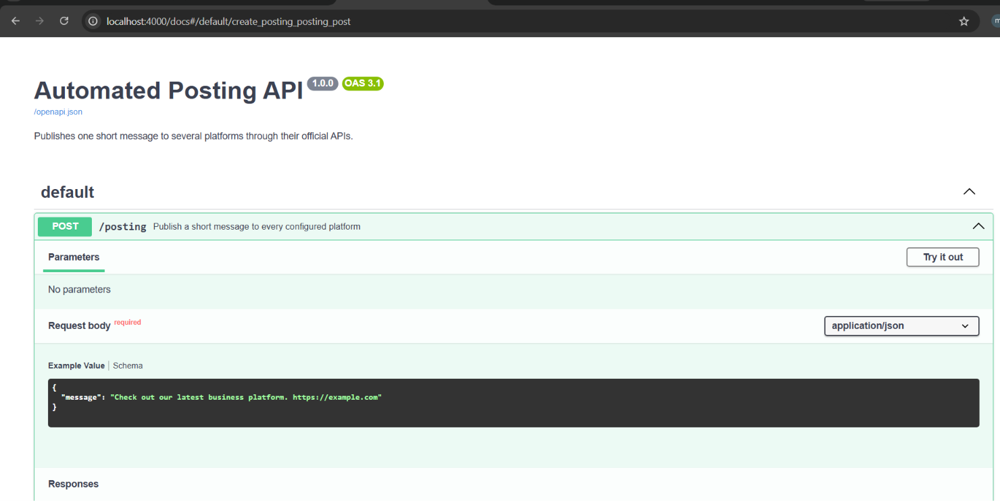
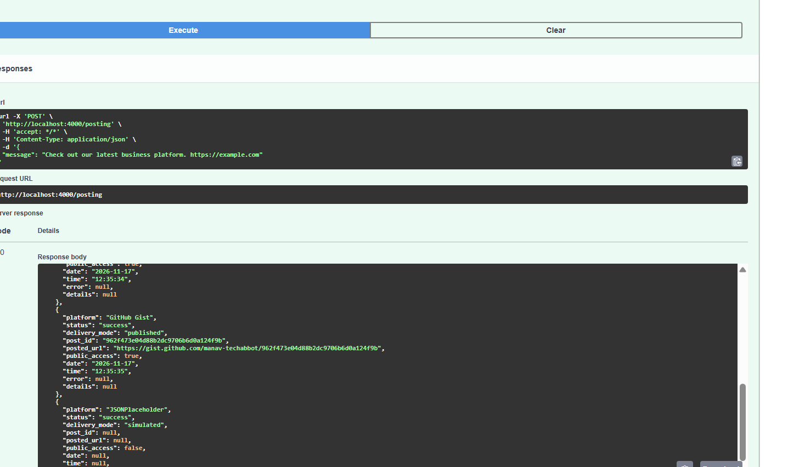
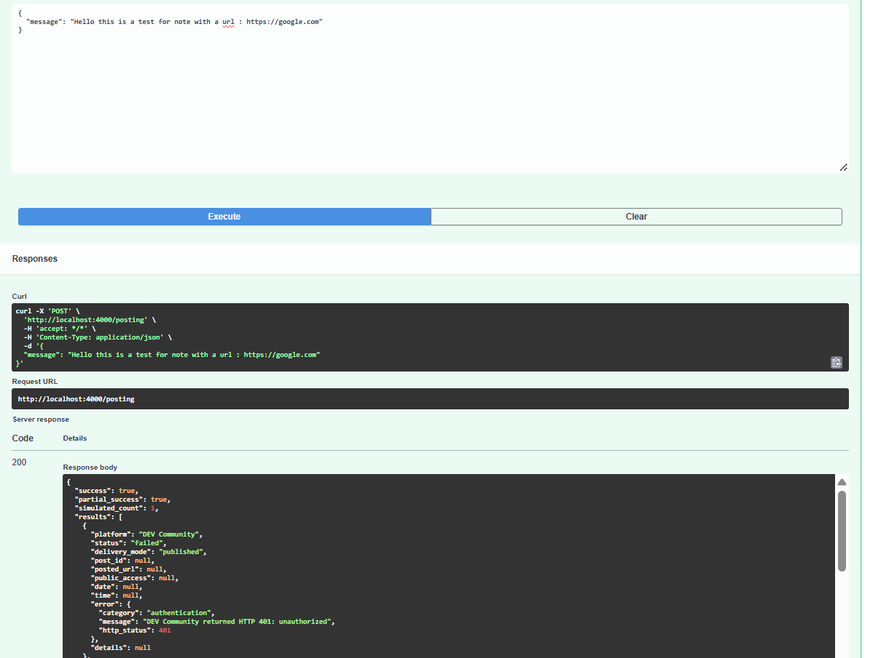
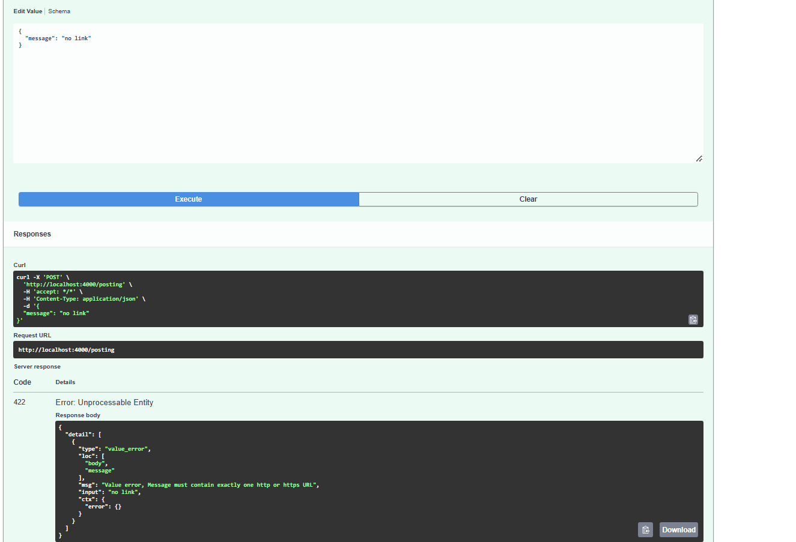

# Screenshots Log

## 1. Swagger docs

Swagger UI at `/docs` for the Automated Posting API (v1.0.0). There's only the one endpoint, `POST /posting`, which sends the message to all the enabled platforms. The example request body is shown there too.

## 2. Successful post

Ran `POST /posting` from Swagger with a valid message. The response has a result for every platform. GitHub Gist came back with `"status": "success"`, `"delivery_mode": "published"` and a public `posted_url`. JSONPlaceholder shows `"delivery_mode": "simulated"` since it's a fake API, so no real URL for that one.

## 3. One platform failing (401)

Here DEV Community failed with a 401 (unauthorized), which shows up under the `authentication` category. The other platforms still posted fine, and the overall response is still 200 with `"success": true` and `"partial_success": true`. This was mainly to check that one platform failing doesn't break the rest.

## 4. Message without a URL

Sent `"no link"` as the message. It gets rejected by validation with a 422 and the error `"Value error, Message must contain exactly one http or https URL"`. Nothing gets sent to any platform in this case.

